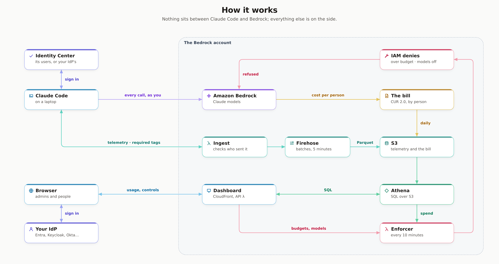
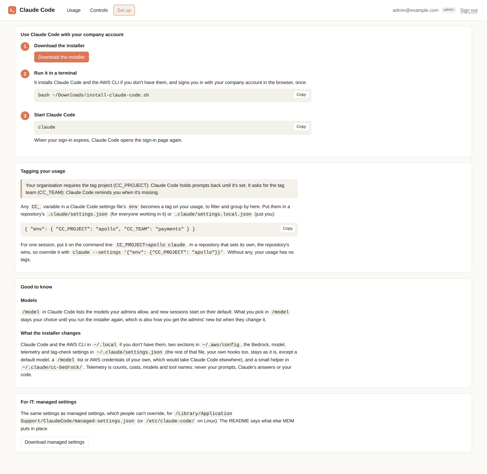
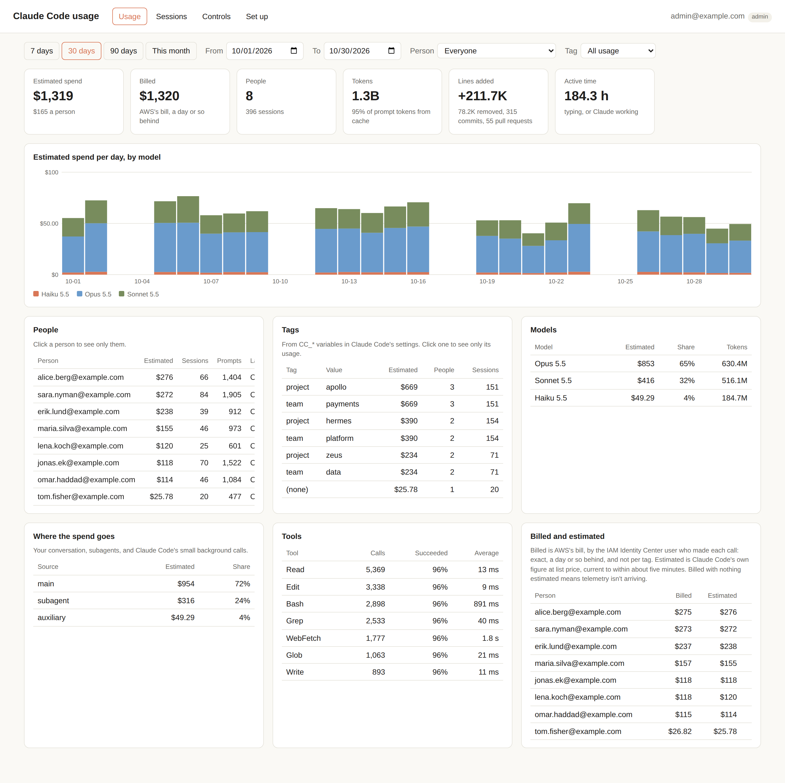
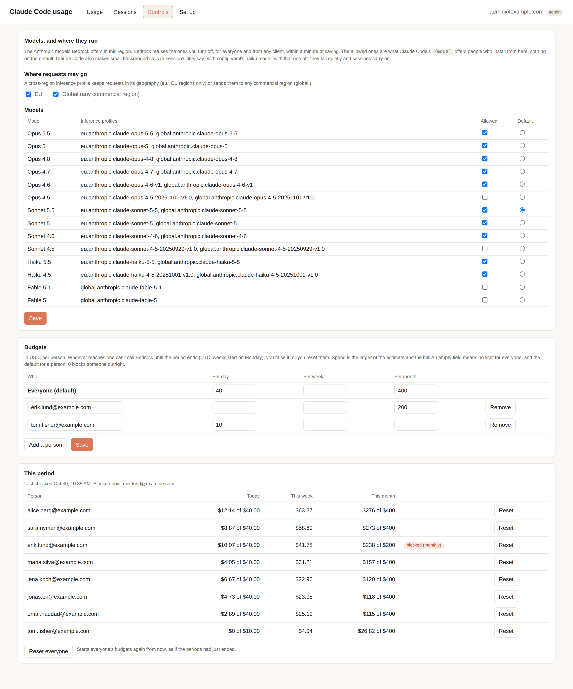

# Claude Code on Amazon Bedrock, for an organisation

An opinionated, small path to giving a whole organisation Claude Code on Amazon Bedrock:
people sign in with the company account they already have, every call is billed to them by name, there's a
self-service page to see your own usage and download the setup, and admins set budgets and allowed models that
Bedrock enforces.



Nothing sits between Claude Code and Bedrock, and nothing is always on: no servers, no database.

## Buy, run a gateway, or this

| | Inference goes through | Per-user cost | Runs |
|---|---|---|---|
| **Buy**: hosted LiteLLM, OpenRouter… | their servers | their feature | nothing |
| **Gateway**: LiteLLM OSS, Anthropic's [Claude apps gateway](https://code.claude.com/docs/en/claude-apps-gateway) | your server | the gateway's (estimated) | a service + Postgres, in the hot path |
| **This**: direct to Bedrock, IAM Identity Center | AWS only | **on the AWS bill, by name** | serverless, idle when unused |

Buying is the simplest by far, if sending inference through a third party is acceptable. A gateway makes sense
when you want one endpoint for many providers, fallbacks, or people to sign in to your IdP with no AWS anywhere;
Anthropic's own gateway calls Bedrock with one AWS identity, so the bill sees one user. For an organisation that
already runs AWS and Identity Center, the path here is less to run, and the bill itself knows who spent what.

**Why the bill knows.** Bedrock records the calling IAM principal on every inference line in CUR 2.0
([IAM principal cost allocation](https://docs.aws.amazon.com/bedrock/latest/userguide/cost-mgmt-iam-principal-tracking.html)),
and an Identity Center sign-in is a role session named after the person:
`arn:aws:sts::111122223333:assumed-role/AWSReservedSSO_ClaudeCode_0123456789abcdef/alice@example.com`. The bill is a
day behind and knows people, not projects; Claude Code's own telemetry fills both gaps, signed with the same identity,
so the bill, telemetry, budgets and dashboard all know people by one name.

## What you need

- **An AWS account for Bedrock** (the "Bedrock account"), with quotas to match
  ([Capacity](docs/reference.md#capacity-and-quotas)). Give people no other role there: a broader one would get round
  the controls, and its spend wouldn't show.
- **IAM Identity Center**, with a group for who should have Claude Code, `ClaudeCode` say. Federated to your IdP is
  usual; its own directory works too.
- **An OIDC client in your IdP** for the dashboard ([per IdP](docs/identity-providers.md)). The IdP decides who is
  an admin.
- **To deploy:** the AWS CLI, [uv](https://docs.astral.sh/uv/) and Node.js.
- **On laptops:** macOS or Linux with `python3` and `curl` (on Linux, also `unzip`). Windows: WSL, or MDM.

## Set up

Three teams, each in a place they already own; after the first time, only the platform team is involved again.

| Team | Where | Does | Gives back |
|---|---|---|---|
| Cloud platform | the Bedrock account | `make deploy` | the dashboard's URL and redirect URI |
| Identity | your IdP (Entra ID, Keycloak, Okta…) | one OIDC client for the dashboard | its issuer and client ID |
| Identity Center admins | the management account, or its delegated administrator | the permission set, assigned to groups | the access portal URL |

1. **Deploy** (platform team): `cp config.example.yaml config.yaml` and fill it in: Identity Center's access portal
   URL and home region (its console's *Settings*), your IdP's issuer, and placeholders for the OIDC client, which
   usually doesn't exist yet. For a name of your own, set up [the domain](docs/reference.md#your-own-domain) first.
   Then, with the Bedrock account's credentials, `make deploy`. It prints `Url` and `RedirectUri`, and creates the
   bill's export (its first data arrives within 24 hours).
2. **OIDC client** (identity team): a public client with the code flow and PKCE, `RedirectUri` as its redirect URI,
   and the groups mapped to `admin` and `user` ([per IdP](docs/identity-providers.md)). Put its client ID in
   `config.yaml` and `make deploy` again.
3. **Permission set** (Identity Center admins), with their own credentials and the same `config.yaml`:
   `make permission-set`. It assigns the config's groups (which must exist) to a permission set that refers to three
   policies the stack owns, so models and budgets change in the Bedrock account without them.
   [By hand](docs/reference.md#the-permission-set-by-hand) works too.
4. **Hand it out**: people download the installer from the dashboard's **Set up** tab, or `make client` writes it and
   managed settings to `dist/` for MDM. Then [check it end to end](#checking-a-deployment).

Updating later is `make deploy` again.

## On the laptop

```bash
bash install-claude-code.sh [--no-login]
```



The installer adds Claude Code and the AWS CLI to the home folder if they're missing (no admin rights), the
Identity Center profile to `~/.aws/config`, and Claude Code's Bedrock, model and telemetry settings to
`~/.claude/settings.json`, leaving the rest of it alone. After that it's `claude`: signed out, Claude Code opens the
Identity Center sign-in and waits for it. [What it changes, exactly](docs/reference.md#on-the-laptop).

**Tags.** Every `CC_*` variable in a Claude Code settings file's `env` becomes a tag the dashboard groups by, so put
them in the repository you work in:

```json
// .claude/settings.json (committed, for everyone working in it), or .claude/settings.local.json (just you)
{ "env": { "CC_PROJECT": "apollo", "CC_TEAM": "payments" } }
```

For one session: `CC_PROJECT=apollo claude`. Admins can require tags; [more on tags](docs/reference.md#tags).

**MDM.** `make client` also writes managed settings, which people can't override, and the helper they point at;
[what goes where](docs/reference.md#mdm).

## The dashboard

Signed in with your IdP. Everyone sees their own usage; admins see everyone and can filter to anyone (the API
enforces it). **Usage** has spend estimated and billed, tokens, sessions, tags, models and tools; **Controls** is for
admins; **Set up** has the installer.



## Controls

Admins set these on the **Controls** tab, and Bedrock enforces them through two IAM deny policies, at once and from
any client. Its refusal names the policy, so people see why:

```
API Error: 403 … is not authorized to perform: bedrock:InvokeModel … with an explicit deny in an identity-based
policy: arn:aws:iam::111122223333:policy/claude-code-models-off
```



- **Models**: which are allowed, and the default new sessions start on. `/model` lists the allowed ones, a row for
  each routing that's on (`Opus 5.5 · EU`, `Opus 5.5 · Global`).
- **Where requests may go**: EU only, Global (the most capacity), or both.
- **Required tags**: **Warn** tells people at a session's start; **Require** also holds prompts back until it's set.
- **Budgets**: daily, weekly and monthly limits in USD, a default and per person. Anyone over is denied until the
  period ends, the limit is raised, or an admin presses **Reset**. A guardrail, not a meter: it acts within about 15
  minutes.

[How each works, and its limits](docs/reference.md#controls).

## Checking a deployment

On a laptop, in order:

1. `bash install-claude-code.sh` opens the browser to Identity Center (and on to your IdP), and
   `aws sts get-caller-identity --profile <name>` then shows `assumed-role/AWSReservedSSO_<permission set>_…/<you>`.
   The sign-in reuses whoever the browser is already signed in to the access portal as; with more than one
   Identity Center user, `aws sso login --profile <name> --no-browser` and a private window choose another.
2. `claude` answers, and within about ten minutes you are on the dashboard's Usage page under the same name you
   signed in to the dashboard with. If not: `make logs` shows why the ingest function refused it (an expired
   sign-in, or a role or account that isn't this deployment's), and `/status` in Claude Code shows whether the
   helper works.
3. `aws sso logout`, then `claude`: Claude Code opens the sign-in itself, waits for it, and carries on, with no
   telemetry warning.
4. A daily budget of 0 for yourself on the Controls tab, and within a minute a refusal naming `<name>-over-budget`;
   **Reset** you to recover. A model turned off: `/model` no longer offers it after reinstalling, and asking for
   it by ID is refused naming `<name>-models-off`.
5. A required tag on the Controls tab, then `claude` in a folder without it: the start of the session says what's
   missing, and with **Require** a prompt is held back until `CC_<TAG>` is set.
6. The next day: the Billed column fills in from CUR.

## Operating it

```bash
make status          # last telemetry and CUR files, last controls check, who's blocked
make logs            # the ingest function; FN=ApiFunction or FN=Enforcer for the others
make test            # lint and unit tests, no AWS needed
make destroy         # deletes the stack; the data bucket is kept (and what else stays: docs/reference.md)
```

## Status

Tested end to end with Claude Code 2.1.316 against real deployments in an AWS Organization with IAM Identity Center,
with Keycloak and Cognito as the dashboard's identity provider: `make deploy`, with and without a domain of its own;
`make permission-set`; the installer on a clean Mac, installing Claude Code and the AWS CLI itself, and on one with
Bedrock settings of its own; the Identity Center sign-in, and Claude Code opening it when started signed out;
verified telemetry and tags; required tags warning and holding prompts back; the dashboard for admins and for
people; budgets denying, resetting and releasing someone; models and routings turned off and refused; the `/model`
picker and default; and the bill by person from CUR.

## More

- [docs/reference.md](docs/reference.md): the details of each part, capacity, the bill, data and privacy, cost,
  what's left out, and the repository's layout.
- [docs/identity-providers.md](docs/identity-providers.md): Keycloak, Entra ID, Okta, Cognito.

## Licence

MIT: see [LICENSE](LICENSE).
